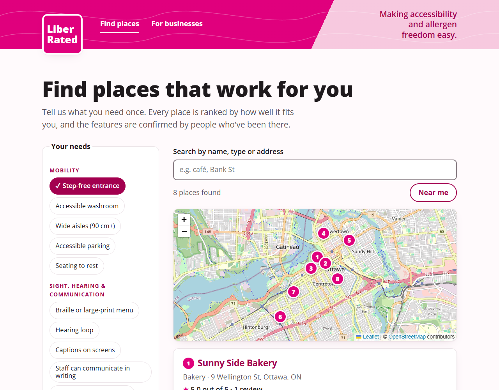
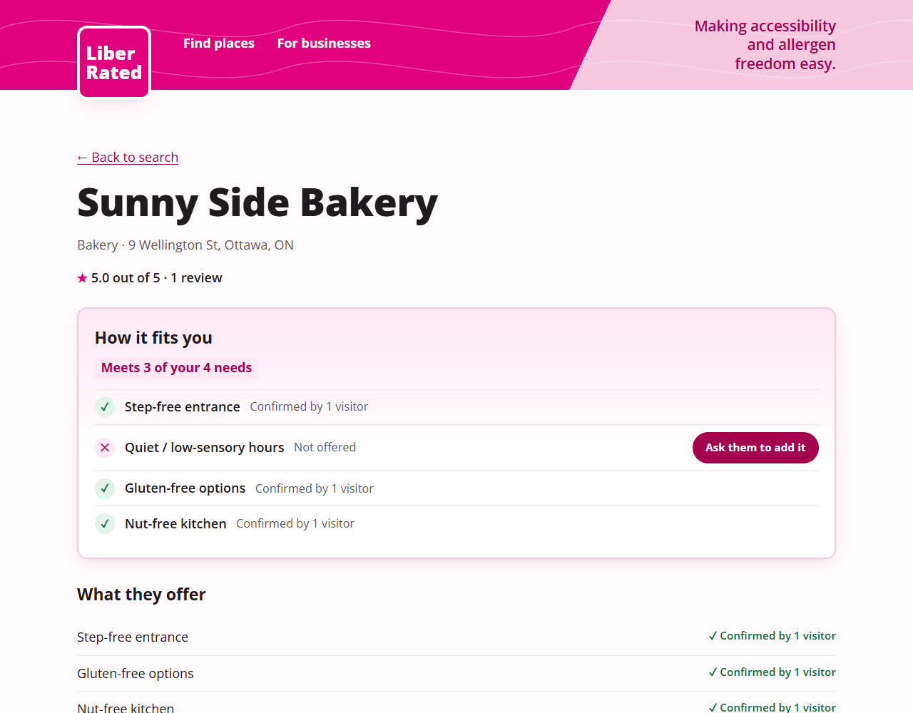
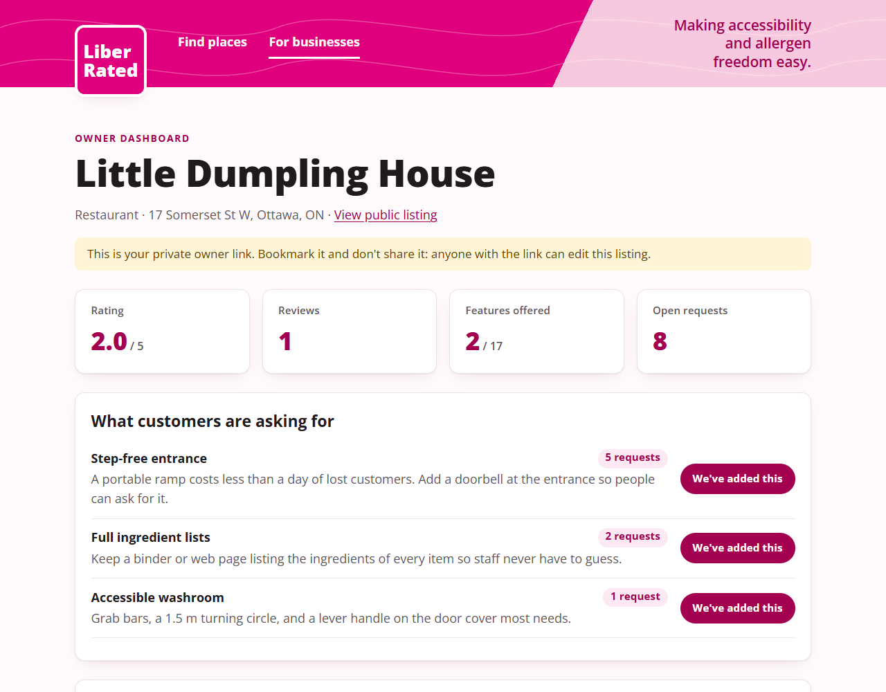

# LiberRated

[](https://github.com/mazentalsam/liber_rated/actions/workflows/test.yml)

**Find places that meet your accessibility and allergen needs, confirmed by people who've been there. Businesses can see what customers are asking for.**

**[Try the live demo →](https://web-production-dc95fd.up.railway.app)** · [Owner dashboard demo](https://web-production-dc95fd.up.railway.app/#/owner/6a0000000000000000000001/demo-owner)



| How a place fits you | Owner dashboard |
|---|---|
|  |  |

**Stack:** React (Vite), Express, MongoDB, Claude API. Tested in CI on every push.

## Engineering highlights

- **Accessible by design.** Every page passes axe-core WCAG 2.2 AA checks with 0 violations. It has a skip link, focus moves to the new page on each route change, status updates are announced, text contrast is at least 7:1, and it supports reduced motion and high-contrast mode.
- **Owner access without accounts.** Publishing a listing returns a private link that holds a random key. The key sits in the URL fragment, which browsers never send to servers, and the server stores only a hash of it.
- **AI summaries for your needs.** Claude reads the reviews and writes 2–3 sentences about *your* needs, including any warnings. Without an API key, the rest of the app still works.
- **Private by default.** Your needs are saved on your device, and your location never leaves it.

## What it does

- **Set your needs once.** Pick from 17 needs (mobility, sight, hearing, sensory, allergens), and places are ranked by how many they meet.
- **"How it fits you".** Each need is shown as confirmed by visitors, listed but not yet confirmed, or not offered.
- **Community verification.** Businesses *list* features, and visitors *confirm* them in reviews.
- **Ask for an upgrade.** Request a missing feature in one tap. The owner sees the request with a low-cost tip for adding it.
- **Map and "Near me".** Numbered pins match the list, and among places that meet the same number of needs, the closest come first.
- **For businesses.** List a place, get an accessibility snapshot, and track requests on the owner dashboard.

## Why I built this

I built this working prototype before my interview with LiberRated to show how I'd approach the product, not just describe it. I focused on what makes the idea work: trust (visitors confirm what businesses claim), a reason for businesses to improve (requests with low-cost tips), and an app that is itself accessible.

## What I'd do next

- Business verification, so only real owners can claim a listing.
- Photo uploads on reviews as stronger proof that a feature exists.
- An automated accessibility test (axe-core) in CI to keep the 0-violations result from slipping.

## Run it

```sh
npm install
npm start          # builds the client and serves everything on http://localhost:3001
```

With no `MONGODB_URI` set, the server starts a local MongoDB in `server/.data` and loads fictional demo businesses. Delete that folder to reset. Set `MONGODB_URI` to use a real database, and `ANTHROPIC_API_KEY` to turn on AI summaries.

Try the demo owner dashboard at `/#/owner/6a0000000000000000000001/demo-owner`.

Development: `npm run dev -w server` and `npm run dev -w client` in two terminals (Vite proxies `/api`). Tests: `npm test`.

## Layout

```
shared/features.js   feature list used by both client and server
server/app.js        API: places, reviews, upgrade requests, insight
server/insight.js    Claude summary of reviews for a visitor's needs (claude-opus-5-5)
server/geocode.js    address to coordinates via OpenStreetMap Nominatim
server/seed.js       fictional demo data
client/src/          React views: Search (with MapView), Place, ListBusiness, Owner
```
